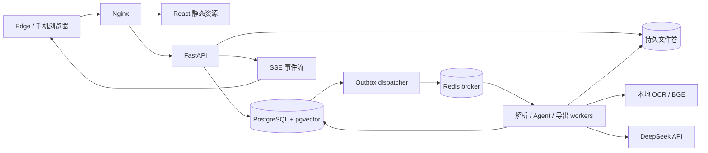

# 03 系统架构与一致性

## 1. 组件

模块边界：auth、files、ingestion、search、agent、exports、tasks、audit。API router 只校验协议、鉴权与调用 service；service 管理事务和权限；repository 执行 SQL；外部组件经 provider/storage/parser 接口访问。Agent 只调用 service，不持有任意数据库/文件系统权限。

建议代码目录：`backend/app/{api,core,models,repositories,services,workers,agent,providers}`、`backend/tests`、`frontend/src/{routes,features,components,lib}`、`infra`、`evals`、`docs`。本轮仅创建 docs，不表示这些源码已存在。

## 2. 上传到检索的数据流

1. 校验账户与容量 → 流式写临时文件、限制大小并计算 SHA-256。M2 锁定用户额度行并在元数据事务中记账；M3 异步任务再使用额度预留。
2. 检查魔数、MIME、容器结构；将 blob 原子改名到随机存储键；事务创建 document/version。M2 同步写入且标记 `not_started`；M3 起再在同一事务创建 task/outbox。事务失败会回滚元数据、恢复/移除文件；孤儿文件由清理器回收。
3. 上传事务同时创建 task/outbox；dispatcher 发布 task_id 到 Celery，数据库 outbox 记录投递；发布和标记不是原子操作，允许重复消息。M3 parse task 暂停在 `waiting_parser`，M4 启用 ingestion Worker 后再发布。
4. M4 ingestion worker CAS 领取任务租约 → 提取 PDF、Office、文本或图片内容 → 对扫描 PDF/图片运行本地 OCR → 写入带 locator 的 extracted_blocks。任务与版本状态记录提取/OCR 阶段；取消与提交前检查租约及 fencing token。
5. M5 从 extracted_blocks 读取已解析内容，在新 generation 写入 chunks、关键词与向量索引；完成后事务切换 version 的 active_generation/index_mode，并在可检索时激活 document 的 current_version。对已有版本重建索引时不改变 current_version。向量模型暂不可用时可激活完整关键词索引并标记 keyword_only；索引失败则保留旧 generation，不展示半套索引。
6. 保存任务终态和事件；API 从数据库提供进度，浏览器以 SSE 跟进。

M2 上传的 HTTP 201 表示原始文件与资料元数据已同步落库，解析状态为 `not_started`。M3 起上传返回202并原子创建 parse task/outbox；M4 打开 ingestion worker 后投递并保存解析结果。202 只表示已接收，不代表解析完成。M4 `ready` 表示结构化提取完成；仍须等 M5 激活索引后才可检索和切换 `current_version`。

## 3. 状态机

| 对象 | 状态及转换 |
|---|---|
| 文件 | active → trashed → active 或 purging → purged；回收站到期触发 purging |
| 版本解析 | queued → extracting → ocr（可跳过）→ ready；运行中可转 failed/cancelled；M5 索引作为后续独立阶段 |
| 普通任务 | queued → running → succeeded/failed/cancelled；running 可进入 cancel_requested；重试创建新任务 |
| Agent run | queued → running → waiting_approval → queued → running → succeeded；可转 failed/cancelled/expired |
| 审批 | pending → approved/rejected/expired；approved 的执行结果另记 applied/failed |

`waiting_approval` 不占用 worker；数据库保存 run/checkpoint，审批通过后投递恢复任务。图暂停前后的业务副作用必须幂等。pending 审批 24 小时过期；运行时间预算不包含等待时间。

## 4. 重复执行、恢复与取消

- 数据库为任务真相源；Redis 丢失时可从未完成 outbox 和过期租约重新投递。
- 任务租约默认 120 秒，每 30 秒续期；写入携带单调递增 fencing_token，旧 worker 无权提交结果。
- M3 Celery Redis 队列仅携带 task_id；正文、文件名、Key 和用户输入不进入 broker。DB outbox 与 task 同事务写入，worker late-ack，重复投递以状态 CAS 和 fencing token 去重。
- 每个阶段以 `(version_id, pipeline_version, stage, generation)` 判重；最终激活操作在事务里完成。
- 模型调用重试可能产生额外费用；记录 provider request ID 和 attempt，不能声称第三方调用恰好一次。
- 可恢复异常最多重试 3 次，指数退避加 jitter；损坏文件、参数校验错误不自动重试。
- 取消是协作式：DB 置 cancel_requested，worker 在页/阶段边界和提交前检查；OCR 在单个页面调用内完成后响应取消。上传大小、页数和栅格像素限制资源消耗；强制终止异常 worker 由 Celery worker 回收。终态成功后取消返回 409，不能回滚已提交结果。
- 定时恢复器每分钟扫描租约过期/待投递任务；重复恢复靠唯一键和 CAS 抑制。

## 5. 文件写操作与导出

整理计划保存文件 ID、预期 metadata_revision、变更前后值、plan_hash。用户审批绑定 hash 和选中 action IDs，执行前重新验证用户、文件状态与 revision。批量元数据修改最多 100 个文件，在一个数据库事务内全成或全败；冲突返回 `STALE_PLAN` 并重新预览。

用户手动选择文件直接导出是其明确操作；Agent 生成的资料包仅在方案确认后创建导出任务。ZIP 使用确定的 version_ids，读取受权 blob，写临时 ZIP 再原子发布；条目名移除路径与危险字符，冲突追加短 ID。Agent 资料包的 manifest.json 标明文件名、版本、SHA-256、来源引用与缺失项；手动导出的 manifest 只含文件清单与校验和。导出前与下载时再次验证源文件仍可访问；文件进入回收站后相关包立即禁用并异步清除。下载 URL 是鉴权 API 路径，非公开静态路径。

导出启动时按原文件总大小加ZIP头/清单余量预留容量，流式输出超过预留上限则原子追加预留或失败；成功按实际字节结算，失败释放预留。上传、导出、删除共用配额服务并锁定用户额度行。清理任务无额外容量需求。

## 6. 检索一致性

所有检索在 SQL 中限定 owner_id、active 文件、current_version、active_generation。搜索默认使用当前版本；显式查看历史引用可读取仍保留的历史版本。模型上下文和最终引用输出前再次检查权限/删除状态，发生变化则拒绝输出相关内容并提示重新生成。

全文、向量索引随 generation 激活一起生效；缓存键包含 owner_id 和 index_revision。删除立即隔离检索并撤销导出可用性，物理删除异步重试。
