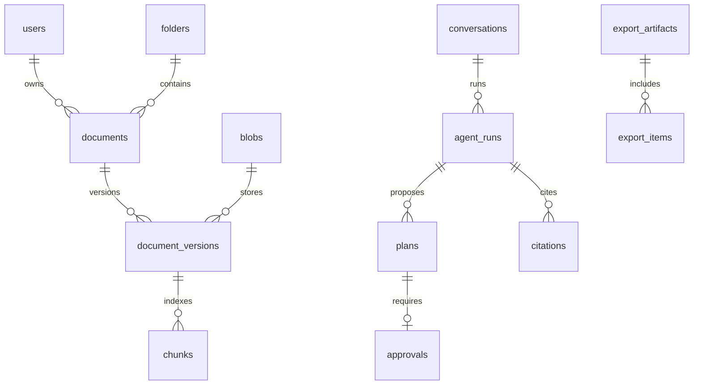

# 04 数据库逻辑设计

PostgreSQL 17，时区 UTC。ID 使用 UUID；时间 timestamptz；业务字节数 bigint；所有用户数据带 owner_id。M3 已迁移 `tasks` 和 `outbox`；M2 已迁移 `folders`、`tags`、`blobs`、`documents`、`document_versions`、`document_tags` 和 `idempotency_keys`；M1 已迁移 `users` 与 `sessions`。其余表是后续模块的设计依据。

## 1. 表结构

通用字段除另有说明均含 id、created_at、updated_at。`?` 表示可空；FK 删除默认 RESTRICT，物理删除由业务流程显式完成。users 以 id 为自身身份，sessions 以 user_id 引用用户；outbox 只保存资源 ID 和调度信息，其他私人业务表使用 owner_id。

| 表 | 关键字段与关系 |
|---|---|
| users | email 唯一、password_hash、is_active、quota_bytes、used_bytes、reserved_bytes、ai_enabled=false、index_revision、password_changed_at |
| sessions | user_id、token_hash 唯一、csrf_hash、expires_at、last_seen_at；仅存令牌散列 |
| folders | owner_id、parent_id?、name、revision；同 owner 的树，不允许循环，深度≤10 |
| tags | owner_id、name、color；UNIQUE(owner_id,name) |
| blobs | owner_id、sha256、storage_key 唯一、size_bytes、mime、state；UNIQUE(owner_id,sha256) |
| documents | owner_id、folder_id?、title、favorite、state、current_version_id?、metadata_revision、trashed_at? |
| document_versions | owner_id、document_id、blob_id、version_no、original_name、parse_state、index_mode?（hybrid/keyword_only）、active_generation?、pipeline_version、page_count?、error_code?；UNIQUE(document_id,version_no) |
| document_tags | owner_id、document_id、tag_id；联合主键(document_id,tag_id) |
| chunks | owner_id、version_id、generation、ordinal、text、locator JSONB、token_count、embedding? vector(512)、embedding_model?、search_vector tsvector；UNIQUE(version_id,generation,ordinal) |
| extracted_blocks | owner_id、version_id、generation、ordinal、kind、text、locator JSONB、ocr_confidence?；保存预览与定位信息 |
| tasks | owner_id、kind、resource_id、version_id?、status、stage、progress_completed/total?、attempt、lease_until?、fencing_token、heartbeat_at?、error_code?、cancel_requested、retry_of?、dispatch_seq、last_enqueued_at? |
| outbox | event_type、aggregate_id(task_id)、dispatch_seq、payload JSONB（只含 task_id）、published_at?、next_attempt_at、attempt；UNIQUE(event_type,aggregate_id,dispatch_seq) |
| conversations | owner_id、title、scope JSONB、revision |
| messages | owner_id、conversation_id、role、content、run_id?、redacted_at?；服务端分配 role |
| agent_runs | owner_id、conversation_id?、mode、instruction、scope JSONB、status、task_id?、graph_thread_id 唯一、token_usage JSONB、budget JSONB、model、prompt_version、started_at?、finished_at? |
| run_steps | owner_id、run_id、seq、tool_name、safe_input JSONB、safe_output JSONB、status、duration_ms；UNIQUE(run_id,seq) |
| plans | owner_id、run_id、revision、actions JSONB、plan_hash、expires_at；UNIQUE(run_id,revision) |
| approvals | owner_id、plan_id、plan_hash、selected_action_ids JSONB、decision、execution_status、decided_at?；UNIQUE(plan_id) |
| citations | owner_id、message_id?、run_id、document_id、version_id、chunk_id?、locator JSONB、quote?、status；status=available/trashed/unavailable |
| export_artifacts | owner_id、run_id?、task_id、storage_key?、size_bytes?、state、expires_at（24小时） |
| export_items | owner_id、export_id、document_id、version_id；UNIQUE(export_id,version_id) |
| audit_events | owner_id、actor_id、action、resource_type、resource_id、request_id、details JSONB；只追加，避免保存全文 |
| idempotency_keys | owner_id、route、key、request_hash、response_status、response_body、expires_at；UNIQUE(owner_id,route,key) |
| stream_events | owner_id、run_id、seq bigint、event_type、payload JSONB、created_at；UNIQUE(run_id,seq)，保留7天 |
| quota_reservations | owner_id、resource_id、bytes、expires_at、state；上传/导出预留额度，到期释放 |

LangGraph checkpoint 表由固定版本的 PostgresSaver 迁移管理，使用单独 schema `agent_state`；graph_thread_id 由服务端生成并通过 agent_runs 映射授权，客户端不能直接指定。

## 2. 关系与约束

- 对所有被跨表引用的用户资源建立 UNIQUE(owner_id,id)，使用包含 owner_id 的复合 FK，防止 A 用户文件引用 B 用户文件夹/标签/版本。
- `documents.current_version_id` 与 `latest_version_id` 必须属于该 document；建立 `(id,version_id)` 到 versions `(document_id,id)` 的延迟 FK。M2 首版上传时两者指向初始版本，新增版本时仅更新 latest；文件内容尚未进入解析流水线。
- 同用户相同 blob 可复用，但只有显式版本上传才在现有 document 下创建新版本。普通上传若匹配 active 文件的当前版本，则返回已有文档列表；只匹配历史版本或回收站文件时可以新建 document 并复用 blob；不跨账户去重。
- quota 更新锁定 users 行，约束 `used_bytes>=0`、`reserved_bytes>=0`、二者和≤quota；物理 blob 按用户唯一对象计费，删除最后引用后扣除。
- metadata_revision 每次修改递增；current_version 激活、进入回收站也递增，令旧整理计划失效。
- 文件夹 sibling 名称唯一用 PostgreSQL `NULLS NOT DISTINCT`，根目录 parent_id=null；收件箱是 folder_id=null 的虚拟视图，数据库中不另建收件箱目录。删除含子文件夹或文件的目录返回409，用户先移动内容。目录移动校验祖先链。

## 3. 索引

- documents(owner_id,state,updated_at DESC,id)、(owner_id,folder_id,state)、收藏部分索引。
- versions(document_id,version_no DESC)、chunks(owner_id,version_id,generation)、GIN(chunks.search_vector)。
- 初始向量查询用过滤后的精确 cosine distance；如加 HNSW(vector_cosine_ops)，必须测试过滤后的召回，不能只按 ANN 返回再在应用中过滤。
- tasks(status,lease_until)、outbox(next_attempt_at) WHERE published_at IS NULL。
- audit_events(owner_id,created_at DESC)、stream_events(run_id,seq)、sessions(expires_at)。

## 4. 生命周期与迁移

- 原始 blob 不覆盖；更新产生新版本。重建索引生成新 generation，激活后延迟清理旧 generation。
- 引用保存版本与定位快照；片段清理后仍可定位该版本。文件进回收站时，历史回答隐藏对应原文片段和引用摘录，引用标记为 trashed；恢复后重新校验可定位。永久删除时 quote 置空、locator 不再返回、status=unavailable。
- 删除某文件时，包含其内容的聊天回答、run 工具结果、计划、事件和 checkpoint 一并清理或标为已移除；idempotency_keys.response_body 及错误/重放缓存中若含资料正文也要清理。无法安全拆除内容时删除整段关联会话，并在 UI 告知。
- 历史版本保留至文件永久删除；首版不提供单版本删除。导出24小时过期，事件7天，审计90天；备份另按运维策略轮换。
- 本地向量模型故障时允许只有关键词索引的 generation 激活，并标记 index_mode=keyword_only；恢复后重新构建新 generation，再原子切换 hybrid。embedding_model 仅在 embedding 有值时填写。
- 模型/分段策略改变必须新 pipeline_version 并全量重建，禁止不同 embedding 模型在同一个活跃索引混用。
- Alembic 迁移经空库安装和上一版升级测试。DDL 先兼容扩展，再回填，再切换；生产回滚优先回退应用，破坏性迁移前强制备份。
