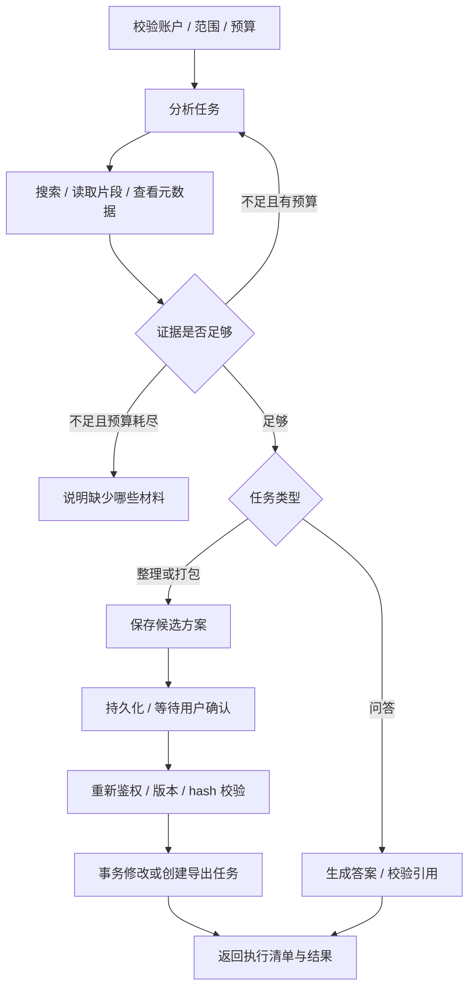

# 06 Agent 与检索设计

## 1. 能力边界

普通上传解析是确定性流水线。Agent 用于需要根据资料决定下一步的任务：选择检索查询、补充证据、生成整理建议、识别资料缺项。首版一个 Agent、三种模式，共用鉴权与工具服务。

## 2. 工具契约

| 工具 | 参数 | 结果 | 权限 |
|---|---|---|---|
| search_documents | query、mode、limit≤20 | chunk_id、片段、locator | 系统注入 owner 与 scope，模型不可扩大 |
| get_document_metadata | document_ids≤20 | 名称、类型、标签、版本、revision | 限本次范围 |
| read_chunks | chunk_ids≤10 | 原文片段、来源 | 检查 owner、版本、文件状态 |
| list_folders | parent_id? | 已有目录 | 当前用户 |
| propose_organization | actions≤100 | plan_id/hash、差异 | 只创建草案，无文件写入 |
| propose_application_pack | version_ids≤100、missing_items、reasons | 材料包草案 | 只创建草案 |

执行元数据修改和创建最终 ZIP 是服务端审批节点能力，不暴露为模型可直接调用的工具。模型不能调用 Shell、SQL、任意 HTTP、浏览器、磁盘路径、删除文件或发送邮件。新增工具必须同时补权限、Schema、幂等与评测。

工具参数由 Pydantic 校验，未知字段拒绝；校验错误最多允许模型修正2次，随后失败。提示注入内容视作文件原文，不能改变工具授权。scope、owner、预算由服务端不可变上下文注入。

## 3. 混合检索

1. PDF 按页、Office 按段落/幻灯片保留边界；使用 BGE tokenizer 分段，目标350 token、重叠50 token，总长度不超过模型上限（初始512，含特殊 token）。一个片段只引用同一定位单元。
2. 标题与正文分别归一化，jieba 中英文混合分词；文档与查询使用相同词典版本。将分词后的安全 token 构造 `simple` tsvector/tsquery，SQL 参数化，禁止把用户原文拼接成查询语法。
3. 关键词 Top30 与向量 cosine Top30 均在授权且活跃的范围内查询；以 RRF `sum(1/(60+rank))` 合并，按 chunk_id 去重。
4. 选前8片段进入上下文，同一文件最多4片段；可按问题再检索，最多3轮。约束只用于上下文预算，不能据此声称扫描了全部文件。
5. 空命中不生成有事实断言的回答。低相关阈值通过评测集校准，不将固定 cosine 数字当通用正确率。
6. BGE 不可用时 keyword 正常运行；hybrid 可降级关键词并返回 degraded=true 与原因；semantic 模式返回503。文档可在向量模型暂不可用时完成 keyword_only 索引，后续重建向量索引。解析未完成的文件只参与名称筛选，不参与内容问答。

## 4. 引用契约

给模型的是服务端分配的证据编号 E1、E2 等及正文。模型输出 `{answer,claims:[{text,evidence_ids:[]}],missing_evidence:[]}`。系统验证编号属于实际检索结果，并绑定 version_id 与 locator；丢失/伪造编号允许重生成一次，仍失败则拒绝该回答。

每个来自资料的事实段落至少一条引用；建议和推断明确标注。结构校验只能验证引用存在，不能证明语义正确，语义支持率须人工标注评测。内容生成后、发送前重查文档状态，资料删除则放弃受影响答案。历史答案引用过旧版本时标识“历史版本”；原文被永久删除则清理回答并显示“相关资料已移除”。

## 5. 状态与审批

GraphState：run_id、mode、scope_snapshot、messages、evidence_ids、tool_steps、candidate_plan_id、budget_usage、error；不把文件全文无限堆入状态。每次 run 使用独立 graph_thread_id；会话历史由服务端读取最近6轮并限制在8,000 token 内，不跨用户记忆。范围可显式包括收件箱。问答可检索全库，但每次只将实际命中的授权片段绑定版本并送入上下文；整理和资料包最多展开100个文件。

待确认页面展示每项变更前后值与原因。审批包含 plan_hash 与 selected_action_ids；hash 使用规范化 JSON，包含操作、文件 ID、版本/revision。24小时内有效；文件变动、被删除、目标目录不存在、当前用户关闭 AI 均要重新评估，不能复用旧批准执行新方案。

元数据执行日志以 `(approval_id,action_id)` 唯一判重，并在同一事务记录 applied。恢复任务先查询是否已应用，再决定继续，避免图节点重放重复修改。用户拒绝审批使 run 进入 cancelled；超时进入 expired。Agent 资料包审批通过后只为勾选的原文件创建导出任务，手动导出不使用 Agent 方案。

## 6. 模型请求与费用预算

- 默认每 run 最多8次 LLM请求、12次工具调用、3轮检索、累计32,000输入/8,000输出 token；每次输出上限2,000 token。包括重试和修复调用。
- 调用前按 tokenizer/保守估算预留输入与最大输出额度，收到 usage 后结算；未收到 usage 不能记零费用，保留估算值。
- 默认主动运行预算300秒（不含排队、人工等待）；单请求连接10秒、读超时90秒；429/临时5xx最多2次带 jitter 重试，受总预算限制。
- 每用户同时最多2个活动 run、每天默认100个 run，限额可配置；不把该配置作为模型费用硬保证。
- DeepSeek Key 只在服务端；空 Key 时 AI 接口返回503 AI_NOT_CONFIGURED。首版 Chat API 显式设置 `thinking.type=disabled`，模型可提出普通工具调用，所有参数仍由服务端校验。模型调用 adapter 支持 mock/real 明确分离，mock 结果必须标记且不得计入真实评测。
- 首次启用 AI 告知：问题和选中资料的相关片段会发送到 DeepSeek；本地 OCR/向量不等于全部处理离线。

记录 model、prompt_version、retrieval_version、pipeline_version、token usage、耗时、错误及人工反馈。默认日志不包含完整提示词与资料正文。
